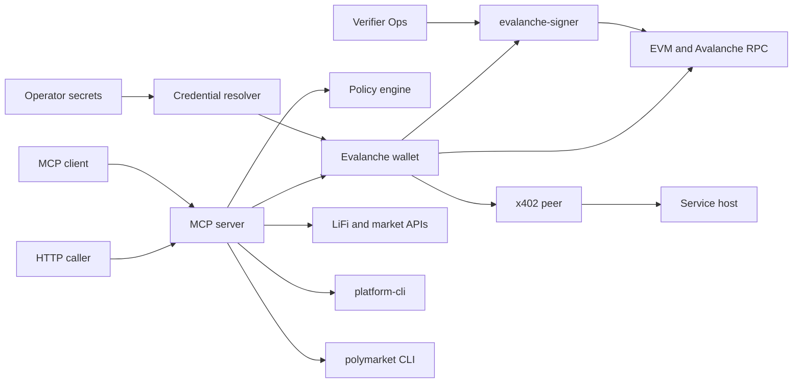

# Evalanche Adversarial Threat Model

## Executive summary

Evalanche is a TypeScript SDK and MCP server that can hold wallet credentials and execute high-impact on-chain actions across EVM, Avalanche P/X-chain, Polymarket, Hyperliquid, bridge, swap, and x402 flows. This hardening pass addressed the highest-risk preconditions: HTTP MCP now requires bearer-token authentication, binds to loopback by default, and enforces request body limits; high-risk helper execution paths now run through the policy hook; policy removal requires explicit confirmation; x402 service endpoints require a settlement verifier unless deliberately configured for signed-intent mode; and authenticated Polymarket trading now routes through an official CLI subprocess wrapper with JSON-only parsing, private-key redaction, and minimal environment inheritance. v1.15.0 adds a remote signer so the agent process can run with no private key. The signer process holds the key, requires an Ed25519 approval from a pinned verifier, and writes an append-only audit log. Residual risk remains around trusted local MCP callers, a compromised signer or verifier, external quote/API integrity, dependency reachability, CLI provenance/installation, and policy coverage for venue-specific off-chain order semantics.

## Scope and assumptions

In scope: runtime SDK and MCP server code under `src/`, package/CLI metadata in `package.json`, and security posture notes in `SECURITY.md` / `VULN_NOTES.md`.

Out of scope: `website/`, generated `website-dist/`, archived docs, release helper scripts, tests except as supporting evidence, and smart contract audits for `contracts/`.

Assumptions:

- The npm package may be embedded in local agents that load a funded private key, mnemonic, macOS Keychain secret, environment secret, or keystore.
- `evalanche-mcp` stdio is intended for trusted local MCP clients. HTTP mode now requires `EVALANCHE_MCP_HTTP_TOKEN` or `startHTTP({ authToken })`, and binds to `127.0.0.1` unless a caller opts into another host.
- Network attackers do not know wallet secrets directly. HTTP attackers also need the MCP bearer token unless another bug leaks or forwards it.
- External APIs and tools such as Li.Fi, Polymarket, Hyperliquid, CoinGecko, RPC providers, IPFS gateways, the official `polymarket` CLI binary, and `platform-cli` are semi-trusted dependencies, not controlled by this repository.
- Severity assumes mainnet-capable wallets with non-trivial balances. Testnet-only usage lowers impact.

Open questions that would materially change risk ranking:

- Are MCP bearer tokens ever exposed to browser contexts, logs, or less-trusted local tools?
- Are MCP callers always mutually trusted, or can LLM/tool-routing output or other local users reach stdio/HTTP with the token?
- Which settlement verifier should production x402 service hosts use for each supported chain/currency?

## System model

### Primary components

- Public SDK API: `Evalanche` exports wallet boot/generation, identity, transactions, x402, bridge, swap, DeFi, prediction market, and perp clients from `src/index.ts`.
- Credential resolution: `resolveAgentSecrets` checks OpenClaw secret refs, raw env vars, macOS Keychain, then keystore fallback in `src/secrets.ts`.
- Wallet execution core: `Evalanche.send`, `Evalanche.call`, bridge/swap/perp/DeFi helpers sign through the configured signer in `src/agent.ts`. A local private key or mnemonic still signs in-process. A `RemoteSignerConfig` or `SigningProvider` forwards the canonical request and never exposes key material. Address-only mode does not sign.
- MCP server: `EvalancheMCPServer` exposes wallet, bridge, swap, Polymarket, perp, policy, service, memory, and platform-cli tools over stdio or HTTP in `src/mcp/server.ts`.
- External integrations: Li.Fi, Gas.zip through Li.Fi, Avalanche Data API L1 catalog, Polymarket CLOB/bridge/Gamma APIs, the official `polymarket` CLI, Hyperliquid, CoinGecko, RPC providers, IPFS, and `platform-cli`.

### Data flows and trust boundaries

- Operator/environment -> credential resolver: private keys, mnemonics, secret refs, keychain entries, keystore files. Channel is process env, subprocess, Keychain CLI, and filesystem. There is no user auth boundary inside the package; process access is assumed trusted.
- MCP client -> MCP server: JSON-RPC messages over stdio or HTTP. Stdio inherits the parent process trust boundary. HTTP now requires a bearer token, defaults to loopback, rejects oversized bodies, and uses POST JSON parsing.
- MCP server -> wallet signer: tool arguments become signatures, native transfers, contract calls, token approvals, bridge/swap execution, Polymarket orders, and perp orders. Native send/call, generic approval/proxy helpers, Li.Fi bridge/swap, and Gas.zip execution now run through the active policy hook. With a remote signer, the MCP process does not hold the key; it posts the request to `evalanche-signer`.
- Agent -> remote signer: HTTP on `127.0.0.1` or a unix socket in a `0750` directory (`0660` socket), bearer token, request id, and a verifier approval. The signer requires a non-empty allow map, matches the approved transaction object field for field, decodes only known calldata, and then applies nonce, expiry, the hard gas cap, SpendingPolicy, token caps, and simulation. Unknown selectors are denied. `/health` returns `{ ok: true, mode }` where `mode` is `dry-run` or `live`.
- Verifier -> signer: an Ed25519 signature over `evalanche-verifier/v1`, the decision, the mode (`dry-run` or `live`), the signer address, the chain id, and the intent hash. Only `decision=approve` is accepted. The intent hash covers the strict canonical intent, including the transaction object `{to, value, data, chainId, nonce, gasLimit, maxFeePerGas, maxPriorityFeePerGas, gasPrice, type}`.
- SDK -> external APIs/RPCs: quote, route, orderbook, market, Avalanche L1 catalog, and registration metadata over HTTPS or JSON-RPC. `safeFetch` enforces HTTPS, a deadline through response body consumption, caller cancellation, redirect blocking, and response byte caps, with private-network blocking only when callers opt in.
- MCP server -> official `polymarket` CLI: authenticated Polymarket reads, orders, cancellations, balances, approvals, bridge status/deposits, and CTF redemption become subprocess arguments via `execFile`, with `-o json` forced on every invocation. Wallet private keys are never passed in argv; the wrapper passes only a minimal environment including `PATH`, `HOME`, proxy/cert settings, signature type, and `POLYMARKET_PRIVATE_KEY` when signing is required. Non-JSON output fails closed and subprocess errors are redacted.
- MCP server -> `platform-cli`: selected tool arguments become subprocess arguments via `execFile`, not shell interpolation. The subprocess inherits most environment variables and may receive wallet private key via env when configured.
- x402 client/service -> remote peer: a 402 challenge is converted into a signed JSON proof and replayed in an HTTP header. Service endpoints now require a settlement verifier by default; the prior signature-only behavior is available only through explicit `paymentMode: 'signed-intent'`.

#### Diagram

### Remote signer boundary

When `signer` is set, a proposer that does not hold the wallet key is outside the key boundary. It can build a transaction and attach an approval, but it cannot produce a signature by itself. The signer process is inside the boundary: it holds the key, checks the verifier, and is the only component that should be treated as able to move funds. On the Grok Bot box the verifier agent holds the wallet key, so separation of duties between key-holder and verifier is gone. The verifier's Ed25519 approval key is generated on the box into a root-only file (mode 0600), not stored as an environment secret. That deployment is accepted risk TM-008: every agent is uid 1000 with passwordless sudo, `/proc/<pid>/environ` of the launcher is readable without sudo, and the key stays in the signer's initial environ for its lifetime even after `process.env` deletes it. Compromise of the signer host, the bearer token plus a valid approval, or the verifier key still is.

The signer fails closed:

- Startup requires a non-empty allow map of `{chainId -> [{address, selectors, roles?}]}`. An empty map, a missing nonce file, or an empty nonce file refuses to start unless `--init-nonces` is passed for the nonce file. `--init-nonces` records `startedAt`. Approvals whose `createdAt` is earlier than that timestamp are rejected. The nonce file and its directory are fsynced. An exclusive kernel lock refuses a second signer on the same file and is released by the kernel when the process dies. Darwin takes that lock with `O_EXLOCK` (`0x20`), `O_NONBLOCK`, and `O_NOFOLLOW`. Linux opens one sha256-pinned helper, hashes that descriptor, and execs the same descriptor through `/proc/self/fd`. The helper and every parent must be root-owned and not a symlink. A helper exit after the lock is held stops the signer and exits non-zero. The signer does not compile anything and does not search `PATH` or the process cwd. The binary is rebuilt from `docker/flock-helper.Dockerfile` (Ubuntu 24.04, GCC 13.3) and CI rejects a sha256 mismatch. Dry-run consumes the nonce, and the approval signature binds `dry-run` or `live`. Hourly and daily spend records are written beside the nonce file and restored on restart.
- Built-in denials cannot be turned off by config: Benqi sAVAX `redeemInstant`, Polymarket protocol contracts, and Hyperliquid typed data. Hyperliquid is recognized from the EIP-712 domain and types (`Exchange` on chain 1337, `HyperliquidSignTransaction`, and the `Agent` type), not from the venue label. Polymarket typed data is denied when the domain name matches `polymarket` or `ctf exchange`, and when `verifyingContract` is one of those protocol addresses.
- Message and typed-data signing are off unless an allowlist names the message or the domain and primary type. `Permit`, `Permit2`, and `increaseAllowance` stay denied unless `explicitAllows` names them. An opted-in permit still requires the owner to be the signer wallet and the spender to carry the `spender` role. The pinned verifier key must be a canonical prime-order Ed25519 point. Small-order keys, including the identity point, are rejected at startup. Approval signatures must be canonical.
- Calldata is decoded for ERC-20 `transfer` and `approve`, ERC-4626 `deposit` and `redeem`, Benqi `submit` and `requestRedeem`, and Li.Fi `swapTokensGeneric` including `multicall`, plus the Avalanche V3 selectors `swapTokensSingleV3ERC20ToERC20` (`0x4666fc80`) and `swapTokensMultipleV3ERC20ToERC20` (`0x5fd9ae2e`) on GenericSwapFacetV3 `0x31a9b1835864706Af10103b31Ea2b79bdb995F5F`. `swapTokensGeneric` (`0x4630a0d8`) is not registered on the Avalanche diamond. Other Li.Fi selectors, including the native V3 variants, stay denied. Every inner multicall selector is checked against the same allow map. Allow entries name roles, and roles are additive (an address may carry `dex` and `recipient` together): `dex` (`callTo`), `spender` (`approveTo` and approve spenders), `recipient` (ERC-20 transfer recipient, native send, and a Li.Fi V3 receiver), `token` (the asset), and `vault` (deposit and redeem). A token address is never accepted as `callTo`. The first swap leg must set `requiresDeposit`; every later leg must leave it unset. A Li.Fi swap binds leg 0 `sendingAsset` to `tokenIn` and `fromAmount` to `amountIn`, chains each `receivingAsset` to the next `sendingAsset`, and binds the last `receivingAsset` to `tokenOut`. Native `fromAmount` must equal `tx.value`; any other sending asset requires `tx.value` of 0. Later legs are not added into `amountIn`. The receiver must be the signer wallet where the call has one. A V3 receiver must also carry the `recipient` role. A decoded `minOut` must be at least `minAmountOut`. A Li.Fi V3 `minAmountOut` of zero is denied. When the intent carries `quotedAmountOut`, a V3 `minOut` must be at least `quotedAmountOut * (10000 - bps) / 10000`, where `bps` is `maxSlippageBps` or, when that is absent, the bought-token class cap (stables 50 bps, top assets 200 bps, other tokens 300 bps). `maxSlippageBps` above the class cap is denied. A Kyber MetaAggregationRouterV2 `swap` (`0xe21fd0e9`) inside a V3 leg is decoded: the destination token must match the leg, an intermediate `dstReceiver` must be the Li.Fi diamond, and the last leg's `dstReceiver` must be the diamond or an allowlisted recipient. Kyber calldata that cannot be decoded is denied. An approve of zero to an allowlisted spender is accepted so a failed swap can reset its allowance. Approve and swap stay separate transactions, and a spender that also has the `dex` role is not denied: roles are additive, and requiring the two calls in one request would reject the normal two-step flow. Anything that cannot be decoded is denied.
- Token and USD caps price the asset being sold: leg 0's sending asset, or a vault deposit's configured underlying. Native value is priced once. Prices are looked up by address only, over HTTPS, with a TTL, and fail closed.
- Approvals must satisfy `createdAt <= now + 30s`, `expiresAt - createdAt <= 600000`, and `expiresAt > now`. `tx.type` must be 0 or 2. Gas cost `gasLimit * max(gasPrice, maxFeePerGas)` defaults to about 0.02 native tokens and cannot exceed the hard cap of 1 native token. Config may only lower that hard cap.
- The audit log is append-only JSONL. The chain root is set in code to the hex SHA-256 of the UTF-8 string `evalanche-audit-root/v1`. The first record stores that root as `prevHash`. Each later record stores the SHA-256 of the previous line. Records include `txHash`, `to`, `value`, `routeHash`, the key id, and the approval signature. RPC URLs are stripped from errors before they are logged or returned. The signer refuses to start if the chain does not link to the root.
- Config, keystore, and verifier pubkey paths are opened with `O_NOFOLLOW`. The same descriptor is `fstat`ed and read. Those files must be root-owned and not writable by group or other, and every parent up to `/` must be root-owned, not group- or world-writable, and not a symlink. Nonce, audit, budget, and lock directories must be owned by the signer user and mode `0700`. Their parents up to `/` follow the same root-owned rule. The socket directory is mode `0750` and owned by the signer user; the socket is mode `0660`. On macOS, `/tmp`, `/var`, and `/etc` are symlinks, so those paths fail closed. Use `/Library/Application Support/evalanche-signer` for the root-owned files and a `state` directory under it, mode `0700`, for nonce and audit. `verifierPublicKeyPath` is the key that is pinned. `--allow-insecure-file-permissions` exists only so tests can run as a non-root user.
- Address-only MCP mode does not call `resolveAgentSecrets`, so a keychain or env key cannot silently replace the read-only wallet.

Polymarket CLI and Avalanche X/P-chain signing cannot cross this boundary. They throw `REMOTE_SIGNER_UNSUPPORTED` rather than reading a private key from the environment.

## Assets and security objectives

| Asset | Why it matters | Security objective (C/I/A) |
| --- | --- | --- |
| Private key / mnemonic / keystore entropy | Direct control of wallet funds and agent identity. In remote-signer mode this lives only in the signer process. | C/I |
| Verifier key and approval nonce | An attacker who can mint approvals can move funds up to policy. A replayed, expired, dry-run, or deny approval must not sign. | I |
| Signer audit log | Append-only evidence of every allow, deny, and dry-run decision, chained to a fixed root. | I |
| Wallet balances and approvals | Loss of funds or persistent token-spender risk | I |
| Polymarket CLI binary and subprocess environment | Authenticated trading now depends on a local external executable and signer env isolation | C/I/A |
| Agent identity and reputation actions | On-chain identity, trust score, and service reputation can be manipulated | I |
| MCP tool surface | It can sign messages, execute transactions, trade, bridge, and call subprocesses | I/A |
| Spending policy state | Intended guardrail for automated spending | I |
| External route/order data | Drives transaction construction and market execution decisions | I/A |
| x402 service revenue records | Used to decide paid access and reported revenue | I |
| Dependency tree / npm package artifact | Users install and run wallet-capable code | I/C |

## Attacker model

### Capabilities

- Send JSON-RPC POSTs to the HTTP MCP server if reachable and the bearer token is known, leaked, or forwarded by a trusted local caller.
- Influence LLM/tool outputs or local automation that calls MCP tools.
- Control remote HTTPS endpoints used by `pay_and_fetch` or agent registration metadata.
- Return malicious or misleading data from compromised external quote/order/metadata APIs.
- Place a malicious binary earlier in `PATH` or misconfigure `EVALANCHE_POLYMARKET_CLI_BIN` if the local host or deployment packaging is compromised.
- Exhaust process CPU or worker availability by sending frequent HTTP MCP requests after authentication.

### Non-capabilities

- Read process memory, env vars, keychain, or filesystem secrets without another host compromise.
- Modify trusted npm package code after installation unless supply-chain compromise is in scope.
- Break HTTPS/TLS or sign blockchain transactions without access to the signer or a reachable signing oracle.
- Reach stdio MCP unless they control the parent MCP client/process.

## Entry points and attack surfaces

| Surface | How reached | Trust boundary | Notes | Evidence |
| --- | --- | --- | --- | --- |
| MCP stdio JSON-RPC | `evalanche-mcp` default | Parent process to server | Trusted local client assumption | `src/mcp/cli.ts` `main`, `src/mcp/server.ts` `startStdio` |
| MCP HTTP JSON-RPC | `EVALANCHE_MCP_HTTP_TOKEN=... evalanche-mcp --http --port 3402` | Token-bearing network caller to wallet-capable server | Requires bearer token, defaults to loopback, enforces request timeout and body limit | `src/mcp/cli.ts`, `src/mcp/server.ts` `startHTTP` |
| Wallet actions | MCP tools `send_avax`, `call_contract`, `sign_message` | JSON args to signer | Direct signing and transaction execution | `src/mcp/server.ts:2672`, `src/mcp/server.ts:2681`, `src/mcp/server.ts:2693` |
| Bridge/swap/gas funding | MCP tools `bridge_tokens`, `fund_destination_gas`, `lifi_swap`, `lifi_compose` | JSON args plus external quote API to signer | Execution uses quote-provided transaction request | `src/mcp/server.ts:2809`, `src/bridge/lifi.ts:318` |
| Polymarket CLI wrapper | MCP tools `pm_order`, `pm_open_orders`, `pm_trades`, `pm_buy`, `pm_sell`, `pm_limit_sell`, `pm_approve`, and related wallet-backed venue tools | JSON args to subprocess plus signer private key in minimal env | Uses `execFile`, forces JSON output, redacts private key, removes hidden raw/diagnostic write tools | `src/polymarket/cli.ts`, `src/mcp/server.ts` `buildPolymarketCliClient` |
| Generic approval/proxy helpers | MCP tools `approve_and_call`, `upgrade_proxy` | JSON args to arbitrary contract calls | Now calls policy authorization before executing helper transactions | `src/mcp/server.ts` |
| Policy control | MCP tool `set_policy` | JSON args to guardrail state | Removal requires `remove=true` and `confirm="remove"` | `src/mcp/server.ts` |
| x402 client/service | HTTP 402 challenge and `x-payment-proof` | Remote peer to signer/service | Settled endpoints require a settlement verifier; signed-intent mode is explicit | `src/x402/client.ts`, `src/economy/service.ts` |
| Platform CLI | MCP subnet/P-chain tools | JSON args to subprocess | `execFile` avoids shell injection, but operations are privileged | `src/avalanche/platform-cli.ts:178` |
| URL fetchers | `safeFetch` callers | Remote URL/API to parser | HTTPS enforced; private network block is opt-in | `src/utils/safe-fetch.ts` |

## Top abuse paths

1. Wallet drain through token-bearing HTTP MCP: attacker obtains the MCP bearer token or reaches a trusted local caller, calls `tools/call` with wallet execution tools, and the server signs transactions with the loaded wallet.
2. Signature oracle abuse: attacker with MCP access calls `sign_message` and reuses signatures for login, CLOB auth-like flows, or other off-chain authorization protocols that accept arbitrary wallet signatures.
3. Guardrail weakening: attacker with MCP access deliberately removes policy using the explicit removal confirmation or relies on policy gaps for token amounts and off-chain orders, then invokes high-impact tools.
4. Persistent token risk: attacker with MCP access calls approval, vault, swap, or bridge flows to create broad approvals or execute quote-provided calldata, leaving residual token-spender risk after the MCP server is stopped.
5. x402 settlement bypass by misconfiguration: an operator deploys paid endpoints without a production verifier or intentionally uses signed-intent mode for untrusted peers, allowing access without settled funds.
6. MCP HTTP DoS after authentication: attacker with the bearer token sends frequent requests; body size and timeout controls reduce memory risk, but there is no rate limit or concurrency cap yet.
7. External quote/API manipulation: compromised route/order API returns malicious transaction request or misleading market data; policy catches target/value constraints, but semantic quote invariants still need local validation.
8. Polymarket CLI substitution: attacker with local deployment influence places a malicious `polymarket` executable earlier in `PATH` or changes `EVALANCHE_POLYMARKET_CLI_BIN`; authenticated MCP calls then pass order intent and signer env to attacker-controlled code.

## Threat model table

| Threat ID | Threat source | Prerequisites | Threat action | Impact | Impacted assets | Existing controls (evidence) | Gaps | Recommended mitigations | Detection ideas | Likelihood | Impact severity | Priority |
| --- | --- | --- | --- | --- | --- | --- | --- | --- | --- | --- | --- | --- |
| TM-001 | Remote or adjacent network attacker | MCP server is started with `--http`, reachable beyond trusted local clients, and the attacker has or obtains the bearer token. Wallet credentials are loaded. | Send JSON-RPC `tools/call` requests for signing, transfer, bridge, swap, approval, or trading tools. | Direct loss of funds, unauthorized orders, approvals, identity/reputation writes. | Wallet balances, approvals, identity, reputation. | HTTP requires bearer token, defaults to `127.0.0.1`, and has body limits (`src/mcp/server.ts` `startHTTP`); CLI requires `EVALANCHE_MCP_HTTP_TOKEN` (`src/mcp/cli.ts`). | Token leakage or overly broad host binding can still expose the wallet-powerful API; no per-tool auth tiers yet. | Add read-only vs signing scopes, rotateable token files with strict permissions, and optional mTLS for non-loopback use. | Log remote address, tool name, wallet address, tx hash; alert on non-loopback clients and signing tools. | Low to Medium | High | Medium |
| TM-002 | Malicious MCP caller or compromised LLM/tool routing | Attacker can call MCP tools through a trusted local channel or with the HTTP token. A spending policy is configured or expected. | Attempt to remove policy or call helper tools outside normal send/call wrappers. | Guardrail bypass or excessive approvals/spend if a path is not covered by policy semantics. | Policy state, wallet balances, approvals. | Policy removal now requires `remove=true` and `confirm="remove"`; `authorizeTransaction` covers generic approval/proxy, Li.Fi bridge/swap, and Gas.zip execution (`src/agent.ts`, `src/mcp/server.ts`, `src/bridge/gaszip.ts`). | Venue-specific off-chain order semantics and token-amount budgets are not fully represented by native-value policy fields. | Extend policy to token amounts, approval ceilings, typed-data/off-chain order limits, and tool scopes. | Emit structured policy change events; alert on policy removal, dry-run mode, max approvals, and transactions without a policy decision ID. | Medium | Medium to High | Medium |
| TM-003 | Any x402 service consumer | Service host is used to sell access to endpoints. A production settlement verifier is missing, incorrectly implemented, or endpoint is explicitly set to `signed-intent`. | Sign a proof declaring amount/currency/chain without matching settled funds. | Free service access and false revenue accounting. | Service revenue, access control, reputation. | Nonce, TTL, body hash, signature, amount, currency, chain checks exist; settled endpoints require a verifier before serving (`src/economy/service.ts`). | The repository provides the verifier hook, not a complete chain-specific verifier implementation. | Implement and test verifier adapters for supported settlement chains/tokens; reserve `signed-intent` for trusted peer tests and demos. | Log proof nonce, payer, settlement tx/facilitator receipt; alert on missing settlement or repeated unpaid proofs. | Low to Medium | Medium | Medium |
| TM-004 | Malicious or compromised external route/order API | Agent uses quote/order/catalog data from external APIs and signs returned transaction requests or configures a wallet from returned network metadata. | Return transaction request, market data, or L1 metadata that routes value/approvals unexpectedly, misprices execution, or points at the wrong chain. | Fund loss through malicious calldata, excess slippage, wrong recipient, bad approvals, or wrong-chain wallet configuration. | Wallet balances, approvals, trade integrity, network configuration. | HTTPS, redirect blocking, caller cancellation, full-body deadlines, byte caps (`src/utils/safe-fetch.ts`); Li.Fi/Gas.zip transaction requests pass through policy authorization; Avalanche L1 helper verifies `eth_chainId` before returning a network config. | Policy authorization does not yet validate semantic quote invariants like token deltas, final recipient, or known router/spender sets. | Validate quote invariants locally before signing; require chain/provider match; maintain known router/spender allowlists; simulate transaction when possible. | Log route ID, tool, tx target, token deltas; alert on unknown spender/router or destination mismatch. | Low to Medium | High | Medium |
| TM-005 | Remote network attacker | HTTP MCP is reachable and attacker has or can send requests to the token-protected endpoint. | Stream oversized bodies or many requests. | Process memory/CPU exhaustion and agent unavailability. | MCP availability, wallet automation reliability. | POST-only, bearer auth, 10s request timeout, and max body bytes now exist (`src/mcp/server.ts` `startHTTP`). | No per-IP rate limit or concurrency cap yet. | Add rate limiting and concurrency limits for HTTP mode. | Track body sizes, parse failures, request duration, event loop delay, and per-IP rates. | Low | Medium | Low |
| TM-006 | Supply-chain or dependency attacker | Users install package with vulnerable transitive dependencies. | Exploit reachable dependency vulnerability or compromise install/runtime package path. | Wallet compromise, code execution, or data exfiltration depending on reachability. | Wallet secrets, package integrity. | `VULN_NOTES.md` tracks the zero-finding production audit snapshot, package provenance is enabled in `package.json`, and clean consumer gates assert Core/HPKE/dYdX dependency absence. | Future Avalanche SDK and direct compatibility-pin changes can reintroduce drift; audit output must remain complete and internally consistent. | Run reachability triage for runtime imports, keep overrides pinned, and gate release on complete repository and consumer audit reports. | CI audit with allowlist expiry; alert on dependency graph changes in wallet/runtime paths. | Medium | Medium to High | Medium |
| TM-007 | Local supply-chain or deployment attacker | Attacker can influence the installed `polymarket` binary, `PATH`, or `EVALANCHE_POLYMARKET_CLI_BIN` in the agent runtime. | Substitute a malicious CLI that receives signed trading intents and `POLYMARKET_PRIVATE_KEY` for authenticated commands. | Private-key theft, unauthorized market orders, false balances/orders, or suppressed cancellation errors. | Polymarket wallet credentials, balances, order integrity, agent availability. | Wrapper uses `execFile` with argv arrays, never puts private keys in argv, forces `-o json`, caps subprocess output/time, redacts private keys from errors, and fails closed on non-JSON (`src/polymarket/cli.ts`). Hidden raw/diagnostic MCP write paths now throw removal errors (`src/mcp/server.ts`). With a remote signer, Polymarket CLI and X/P-chain paths throw `REMOTE_SIGNER_UNSUPPORTED` and do not read `POLYMARKET_PRIVATE_KEY`. | The repo cannot prove the installed external CLI is official or current at runtime; no version allowlist or binary checksum enforcement exists yet. Local-key mode still passes the key to the CLI. | Pin the CLI in deployment images, add a startup `polymarket --version`/checksum check, document `EVALANCHE_POLYMARKET_CLI_BIN`, and keep production wallet runs on locked images. Prefer the remote signer for shared hosts. | Log CLI binary path/version at startup without secrets; alert on binary path changes, non-JSON CLI output, repeated CLI failures, and signing commands from unexpected MCP clients. | Low to Medium | High | Medium |
| TM-008 | Another local user, or a compromised agent, on a shared host | The agent process is readable by other users, or the agent can be induced to send signing requests. The signer is reachable on loopback or a unix socket and the bearer token is known. | Submit a signing request with a forged, replayed, expired, or mismatched approval, or with calldata that differs from the approved intent. | Unauthorized transfer, unlimited token approval, or a Hyperliquid order if the signer policy is loose. | Wallet balances, approvals, audit integrity. | The verifier agent holds the wallet key, so separation of duties between key-holder and verifier is gone. The real condition is the shared uid 1000 with passwordless sudo: `/proc/<pid>/environ` of the launcher is readable without sudo, and the key stays in the signer's initial environ for its lifetime even after it is deleted from `process.env`. The signer pins the verifier Ed25519 key and accepts only an approval signature over `evalanche-verifier/v1`, decision `approve`, the dry-run or live mode, the signer address, the chain id, and the intent hash. The intent binds the full transaction object. Known calldata is decoded and unknown selectors are denied. Li.Fi legs are bound to the intent, and caps price the sold asset. Spenders, transfer recipients, and inner multicall selectors must be allowlisted. A non-empty allow map is required. Benqi sAVAX instant unstake, Polymarket contracts and typed data, Hyperliquid typed data, Permit, Permit2, and increaseAllowance are denied unless the last three are explicitly allowed. Small-order verifier keys are rejected. Signer files are opened with O_NOFOLLOW. Nonce state is locked, fsynced, and initialized only with `--init-nonces`. Expiry, the hard gas cap, SpendingPolicy (including hourly and daily budgets), address-keyed prices, and simulation from the signer address all run before a signature. The audit log is append-only and chained to a fixed root. Default bind is `127.0.0.1` or a `0660` unix socket in a `0750` directory. | A stolen verifier key, or a signer exposed beyond loopback, still authorizes spends inside the allow map and the gas cap. The audit log is only as trustworthy as the signer host. Li.Fi bridge facets other than `swapTokensGeneric`, `swapTokensSingleV3ERC20ToERC20`, `swapTokensMultipleV3ERC20ToERC20`, and `multicall` of decoded calls are denied because they are not decoded. On Avalanche the diamond returns the zero address for `swapTokensGeneric`; those two V3 selectors are served by GenericSwapFacetV3 `0x31a9b1835864706Af10103b31Ea2b79bdb995F5F`. Accepted risk 2026-10-16, owner Giacomo Barbieri, review 2027-01-16: the verifier agent holds the wallet key. Shared uid 1000 with passwordless sudo means `/proc/<pid>/environ` of the launcher is readable without sudo, and the key stays in the signer's initial environ for its lifetime after `process.env` deletes it. The signer is a policy check against mistakes, confused agents, and bad inputs, and it is not a security boundary against root. Exit triggers are PROPOSED, pending owner confirmation, and the 2027-01-16 review stays pending confirmation. (a) Treasury value above $2,000. The owner's standing rule sweeps $500 out at $1,000. (b) Any agent, person, or service gaining box access beyond the current Grok Bot agent roster, or any suspected compromise. The named action is to move signing to a hosted policy wallet or a separate signer-only host before resuming live trading. On 16 Oct 2026 the owner decided the verifier's Ed25519 approval key is generated on the box into a root-only file (mode 0600, owner root), not an environment secret. See Accepted risks. | On hosts where agents are not root-capable, keep the verifier key offline from the agent and bind the socket to the dedicated signer user. Alert on deny decisions and dry-run approvals presented as live. The production-box acceptance, including the rejected alternatives, is recorded under Accepted risks. | Tail the JSONL audit log for `deny`, repeated nonces, and signing from unexpected request ids. | Medium | High | High |

## Accepted risks

### TM-008 — verifier holds the wallet key; the signer is not a boundary against root

| Field | Entry |
| --- | --- |
| Threat | TM-008 |
| Status | Accepted |
| Date | 2026-10-16 |
| Review | 2027-01-16 |
| Owner | Giacomo Barbieri |

The verifier agent holds the wallet key (`MONY_WALLET_PRIVATE_KEY`, mapped to `EVALANCHE_SIGNER_PRIVATE_KEY` at launch). Separation of duties between key-holder and verifier is gone.

The real condition is the shared uid 1000 with passwordless sudo. `/proc/<pid>/environ` of the launcher is readable without sudo. The key stays in the signer's initial environ for its lifetime even after the process deletes `EVALANCHE_SIGNER_PRIVATE_KEY` from `process.env`. The dedicated signer user, the root-owned install, and mode `0700` state directories cannot stop a malicious root-capable agent.

In this deployment, the signer's job is to enforce policy against mistakes, confused agents, and bad inputs: the allowlist and roles, caps, decode checks, nonce, expiry, and the verifier's Ed25519 approval. It is not a security boundary against root.

On 16 Oct 2026 the owner decided the verifier's Ed25519 approval key is generated on the box (mode 0600, owner root). It is not an environment secret. The public key is mode 0644. The approval step reads the private key with `sudo -n cat` of that file. The key is not passed in the environment or in argv. A reset of the box wipes `/etc`, `/opt`, and `/var`, and it restores `/home` as uid 1000. The key, the token, the config, the audit log, the nonce store, and the pinned tarball live under `/home/box/agent-data/evalanche-persist`. `provision` chowns that tree back to root and to the signer user, recreates the signer user at the same uid, copies the key into `/etc` without generating a new one, and bind-mounts state and log onto `/var/lib/evalanche-signer`. It fails closed if those owners do not stick. Nonces must still be there after the reset. There is no boot hook.

Exit triggers (PROPOSED, pending owner confirmation; the 2027-01-16 review stays pending confirmation):

- Treasury value above $2,000. The owner's standing rule sweeps $500 out at $1,000.
- Any agent, person, or service gaining box access beyond the current Grok Bot agent roster, or any suspected compromise.

The named action is to move signing to a hosted policy wallet or a separate signer-only host before resuming live trading.

Alternatives considered and rejected:

- A KMS or hosted policy wallet.
- A separate host for the signer.
- A Mac mini running the agent as a non-admin user.

## Criticality calibration

- Critical: private key/mnemonic disclosure; dependency RCE in a default-loaded wallet path; authenticated remote access to wallet signing with no effective policy on a funded mainnet wallet.
- High: trusted caller can execute transactions, create broad approvals, or cause paid-service authorization bypass; compromised quote source can cause unbounded fund movement where policy is absent or permissive.
- Medium: denial of service against local agent automation; external metadata manipulation that does not directly sign transactions; dependency vulnerabilities with unclear runtime reachability.
- Low: read-only metadata exposure, test-only issues, docs drift, or issues requiring local process compromise that already implies wallet compromise.

## Focus paths for security review

| Path | Why it matters | Related Threat IDs |
| --- | --- | --- |
| `src/mcp/server.ts` | Central JSON-RPC dispatcher, HTTP transport, wallet-capable tool surface, and policy mutations. | TM-001, TM-002, TM-005 |
| `src/mcp/cli.ts` | Defines HTTP mode and credential-loading CLI behavior. | TM-001 |
| `src/agent.ts` | Policy enforcement and wallet execution orchestration live here. Remote and address-only modes are selected here. | TM-002, TM-004, TM-008 |
| `src/signer/` | Remote client, intent hash, and the reference signer. This is the trust boundary between the agent and the key. | TM-008 |
| `src/economy/policies.ts` | Budget/allowlist semantics and gaps for token approvals/off-chain orders. | TM-002 |
| `src/utils/contract-helpers.ts` | Generic approval and proxy upgrade helpers with arbitrary targets. | TM-001, TM-002 |
| `src/bridge/lifi.ts` | Signs external quote-provided transaction requests. | TM-004 |
| `src/bridge/gaszip.ts` | Gas funding execution path through external quote data. | TM-004 |
| `src/swap/arena.ts` | Direct token approval and swap execution outside `Evalanche.call`. | TM-002 |
| `src/swap/yak.ts` | Direct max approval and router execution path. | TM-002 |
| `src/defi/vaults.ts` | Approves vaults with `MaxUint256` and deposits directly. | TM-002 |
| `src/x402/client.ts` | Creates and sends payment proofs. | TM-003 |
| `src/x402/facilitator.ts` | Signs payment proof payloads. | TM-003 |
| `src/economy/service.ts` | Verifies proofs, requires settlement verification by default, and preserves explicit signed-intent mode. | TM-003 |
| `src/utils/safe-fetch.ts` | Common URL-fetch control point for SSRF, redirects, timeouts, and response caps. | TM-004 |
| `src/avalanche/l1.ts` | Consumes live Avalanche L1 catalog data and verifies RPC chain IDs before producing wallet network configs. | TM-004 |
| `src/avalanche/platform-cli.ts` | Subprocess execution boundary for privileged Avalanche operations. | TM-001, TM-002 |
| `src/polymarket/cli.ts` | Subprocess execution boundary for official Polymarket CLI authentication, trading, balances, approvals, and redaction controls. | TM-002, TM-007 |
| `src/polymarket/client.ts` | Public Polymarket client now delegates authenticated venue operations to the CLI while retaining direct public market reads and bridge/withdraw helpers. | TM-004, TM-007 |
| `package.json` and `VULN_NOTES.md` | Dependency and release posture for wallet-capable package. | TM-006 |

## Quality check

- Covered discovered runtime entry points: SDK API, MCP stdio, MCP HTTP, x402, external API fetches, platform-cli subprocesses, official Polymarket CLI subprocesses, and credential resolution.
- Covered trust boundaries in threats: network-to-MCP, MCP-to-signer, agent-to-remote-signer, verifier-to-signer, MCP-to-policy, SDK-to-external APIs, MCP-to-CLI subprocesses, x402 peer-to-service, and package-to-dependency tree.
- Separated runtime from CI/dev: release scripts, website, and tests are out of scope except where they document posture.
- User clarifications: none provided yet; token handling, caller trust, and production x402 verifier choice remain explicit assumptions.
- Graph orientation: local code-review graph built successfully for 142 files / 1,698 nodes / 13,883 edges on branch `main`.
